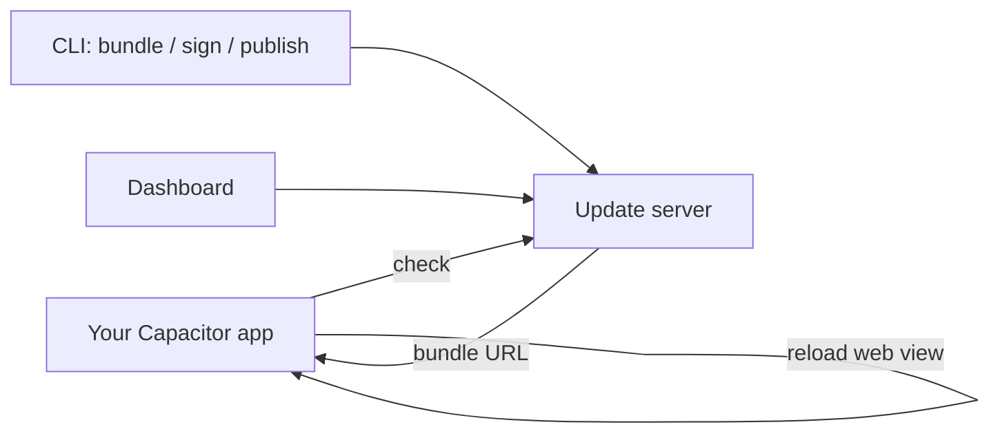

# Introduction

**`native-update` is a Capacitor plugin that ships over-the-air (OTA) JavaScript bundle updates, in-app store update prompts, and native review prompts to mobile apps — without rebuilding or resubmitting them.** It is a single SDK that wraps the four most-asked-for production update flows for hybrid mobile apps, and it talks to the hosted Native Update service or to your own server that implements the documented HTTP contract.

The package lives on npm at [`native-update`](https://www.npmjs.com/package/native-update) and is built and maintained by the Native Update team. From 4.1.2 it ships under the proprietary Native Update License; earlier versions keep the license they were published with.

## What it does

| Capability | What it replaces | One-line summary |
|---|---|---|
| **Live OTA updates** | CodePush / EAS Update / cap-go.com | Push JS + asset bundles to installed apps; channels, signing, and rollback included. |
| **In-app store updates** | Hand-rolled version checks against `itunes.apple.com` and `play.google.com` | Wraps Google Play In-App Updates and the iOS App Store version check behind one API. |
| **App review prompts** | Hand-rolled `SKStoreReviewController` + Play Core wrappers | Triggers the native review sheet at the right moment with safe-by-default throttling. |
| **Background updates** | Hand-rolled WorkManager + BGTaskScheduler scheduling | Battery-aware, network-aware silent update checks with optional notifications. |

All four areas share one configuration object, one event bus, one logger, and one error-code registry. You install one package; you wire one set of native files; you ship four production flows.

## Who it is for

- **Capacitor app teams** who want CodePush-like OTA on Capacitor 8 — without depending on Microsoft's deprecated AppCenter.
- **React, Vue, Angular, and vanilla-JS Capacitor apps** — the SDK is framework-agnostic; examples are framework-specific.
- **Teams that want to run their own update server** — the HTTP contract is fully documented, and the CLI scaffolds a starter server you build on.
- **Teams that want a hosted service** — the same SDK talks to the hosted [Native Update service](https://nativeupdate.aoneahsan.com) with one config change.

## What it is not

Honesty matters more than marketing. Some explicit non-claims:

- **Not a full CodePush drop-in.** The HTTP contract is different. There is a [migration guide](/how-to/migrate-from-codepush).
- **Not the whole system on its own.** This SDK is one half. The other half is a server: the hosted Native Update service, or your own server that implements the documented contract.
- **Not an installer for native binary updates.** "App update" here means "ask the OS to update the binary via the App Store / Play Store" — not "download and install an APK on the user's behalf."
- **Not a replacement for App Store / Play Store review.** OTA updates are restricted to JavaScript, HTML, CSS, and bundled assets. Native code changes still require a store submission. This matches Apple's [App Store Review Guideline 4.7](https://developer.apple.com/app-store/review/guidelines/#4.7) and is the same constraint CodePush operates under.

## Architecture in 60 seconds

1. The CLI builds a bundle from your built web app (`dist/`, `build/`, etc.), strips dev junk, signs it with your private key, and uploads it.
2. Your app calls `NativeUpdate.sync()` periodically (or on resume, or in a background worker) and receives the bundle metadata.
3. The plugin downloads the bundle over HTTPS, verifies its checksum and signature on-device with your public key, and either applies it immediately, on next restart, or on next resume — your choice.

## Where to go next

- **First time?** → [Installation](/getting-started/installation), then [Quick Start](/getting-started/quick-start) (5 minutes).
- **Already installed?** → the reference for [Live Update](/reference/sdk/live-update/overview), [App Update](/reference/sdk/app-update/overview), [App Review](/reference/sdk/app-review/overview) and [Background Updates](/reference/sdk/background-update/overview).
- **Choosing a backend?** → [Backend overview](/backend/overview).

---

## Frequently asked questions

### Is `native-update` an alternative to CodePush?

Yes. CodePush (now in maintenance mode under Microsoft AppCenter) shipped the same model: download a JavaScript bundle, verify it, swap it in. `native-update` ships the same flow on top of Capacitor 8 with a documented HTTP contract you control.

### Does it work on Capacitor 7 or 6?

The current major (`v4.x`) requires Capacitor 8. The plugin's peer dependency in `package.json` is `@capacitor/core ^8.0.1`. Earlier Capacitor majors are not supported by v4 — older majors of this plugin existed for those, but they receive no further updates.

### What does it cost?

The npm package is free to install and use in the apps you build, under the Native Update License. The hosted service at [nativeupdate.aoneahsan.com](https://nativeupdate.aoneahsan.com) has a Free plan and paid plans listed on its pricing page. You can also point the plugin at your own server that implements the documented contract; switching is one config change.

### Will Apple / Google approve apps that use this?

OTA updates are explicitly permitted under both stores' guidelines as long as you only ship JavaScript, HTML, CSS, images, fonts, and other web assets — not native binary code. Apple specifically allows this under [App Store Review Guideline 4.7](https://developer.apple.com/app-store/review/guidelines/#4.7); Google has no equivalent restriction. `native-update` is designed within these constraints.

### Can I sign bundles?

Yes — and v4 requires signed updates by default. The CLI ships `keys generate`, `bundle sign`, and `bundle verify` commands. Every signer and verifier uses RSA-SHA256 (RSASSA-PKCS1-v1_5 with SHA-256); RSA 2048 and 4096-bit keys are supported. The on-device verification happens before the bundle is loaded.

### How do I roll back a bad update?

`NativeUpdate.reset()` rolls the device back to the bundle that shipped with the App Store / Play Store binary. From the server side, marking a bundle inactive in the dashboard (or via the API) prevents new downloads — devices that already downloaded it can still be told to reset via a server-driven command in the next sync response.

### Where is the source code?

Native Update is a SaaS product, not open source. The published package, including its compiled code and type definitions, is on [npm](https://www.npmjs.com/package/native-update); the product source is private. This documentation site is the public reference.

---

<strong>About Native Update</strong>

Native Update and this documentation are built and maintained by the Native Update team. Questions or a gap in these docs? Reach us through the <a href="https://nativeupdate.aoneahsan.com/contact">contact page</a>.

